

  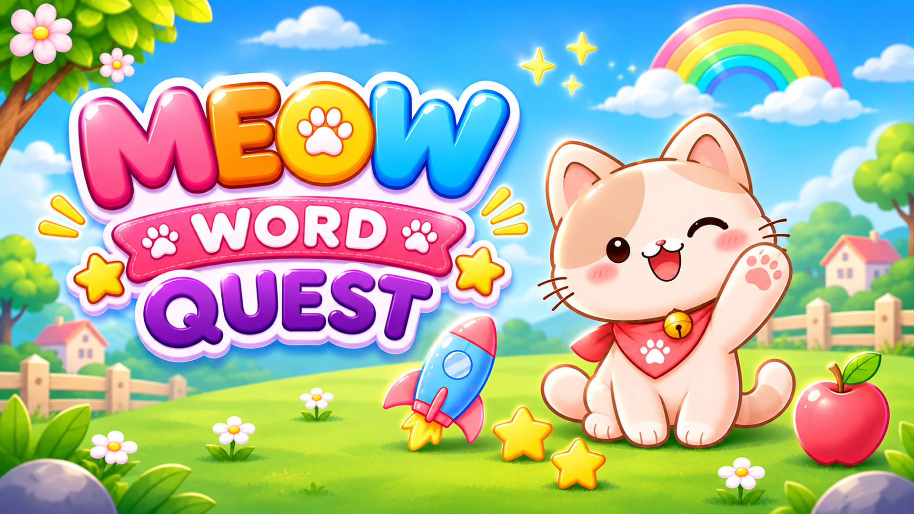

<h1 align="center">Meow Word Quest</h1>

  <b>Spell. Match. Collect.</b> 
  A cozy word puzzle game with a friendly cat guide: spell words, unscramble letters and fill your sticker album.

  
  &nbsp;
  

  <a href="https://bluelolipop1.itch.io/meow-word-quest"><b>bluelolipop1.itch.io/meow-word-quest</b></a>
  &nbsp;•&nbsp;
  <a href="https://playgama.ai/play/6b4q564zngdqyg"><b>playgama.ai/play/6b4q564zngdqyg</b></a> 
  Free, no download, no sign-up. Plays on desktop, phones and tablets.

---

## Trailer

  <a href="media/trailer-landscape-1920x1080.mp4">
    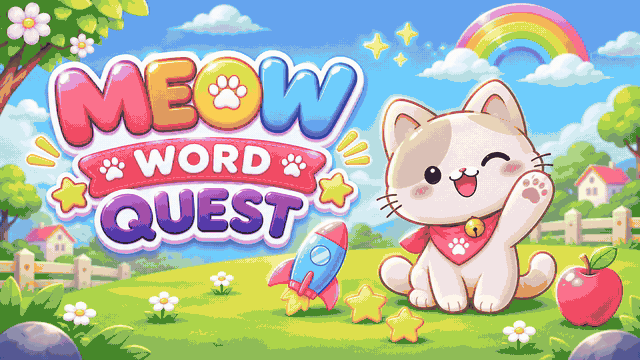
  </a>
   
  Click the preview to watch the full trailer.

  🎬 <a href="media/trailer-landscape-1920x1080.mp4"><b>Trailer (landscape, 1920×1080)</b></a>
  &nbsp;•&nbsp;
  📱 <a href="media/trailer-portrait-1080x1620.mp4"><b>Trailer (portrait, 1080×1620)</b></a>

---

## What's in the game

- **Word Maker**: make words from a set of letter tiles before the timer runs out.
- **Jumbled Word**: put the scrambled letters back in order.
- **Missing Letter**: fill in the letters a word is missing.
- **Match Letters**: drag each letter to the picture that starts with it.
- **Bubble Pop**: pop every bubble with the right letter.
- **Trace**: trace letters with your finger or mouse.
- **Up to three stars** on every level, with worlds that change from sunny meadows to starry nights.
- **Sticker album**: every word you find unlocks an animated sticker.
- **Kitty's voice** reads letters and words out loud.
- **Progress is saved**: you always come back to your highest level.

---

## Controls

| Action | Mouse / touch |
|---|---|
| Spell a word | Tap the letters, then the **green check** |
| Mix the tiles | **Shuffle** button |
| Delete the last letter | **Red** button |
| Match Letters | Drag a letter to its picture (or tap the letter, then the picture) |
| Hint | **Light bulb** |

---

## Gameplay

  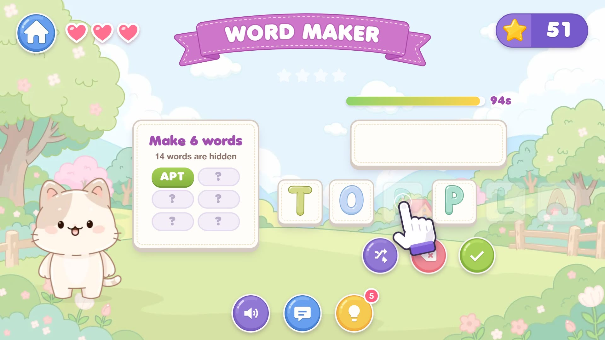
  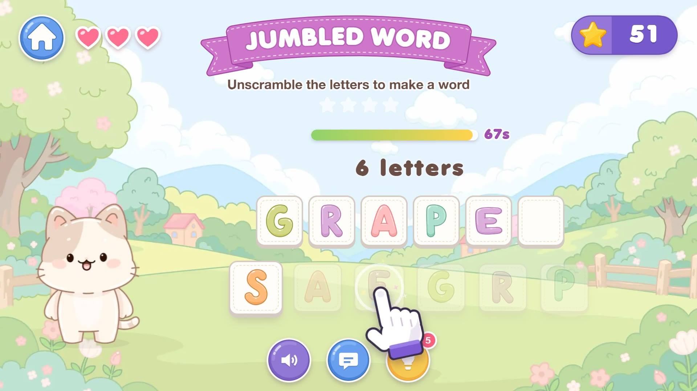

  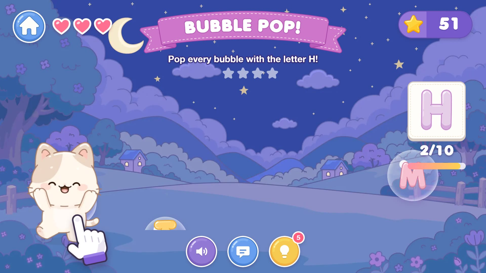
  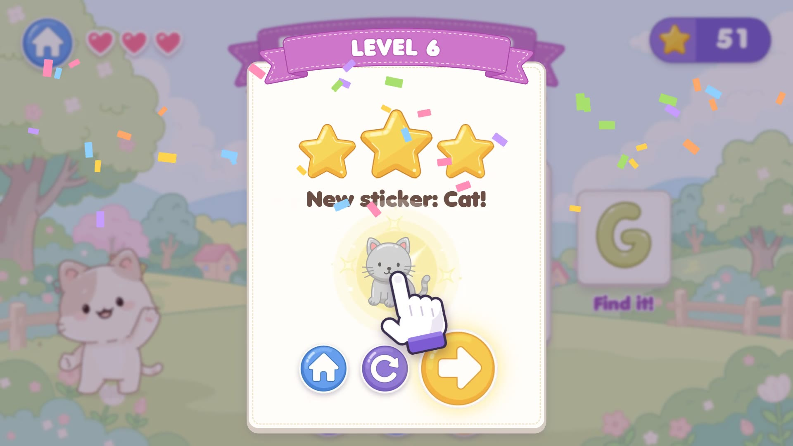

  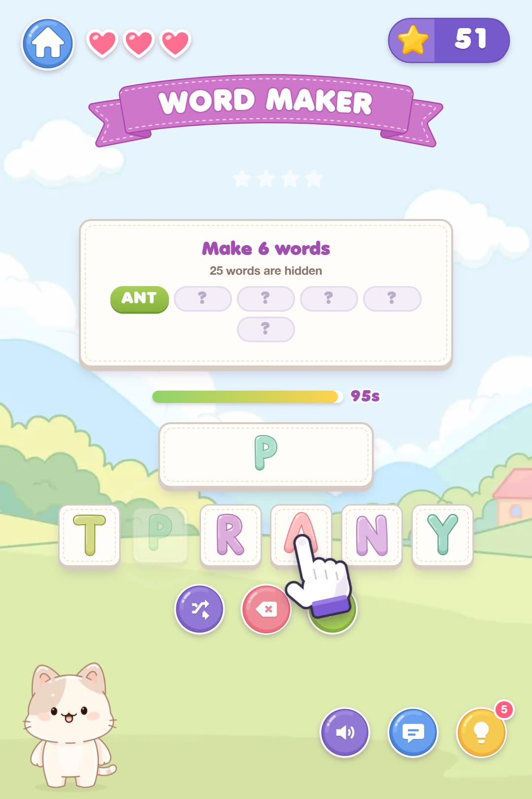
  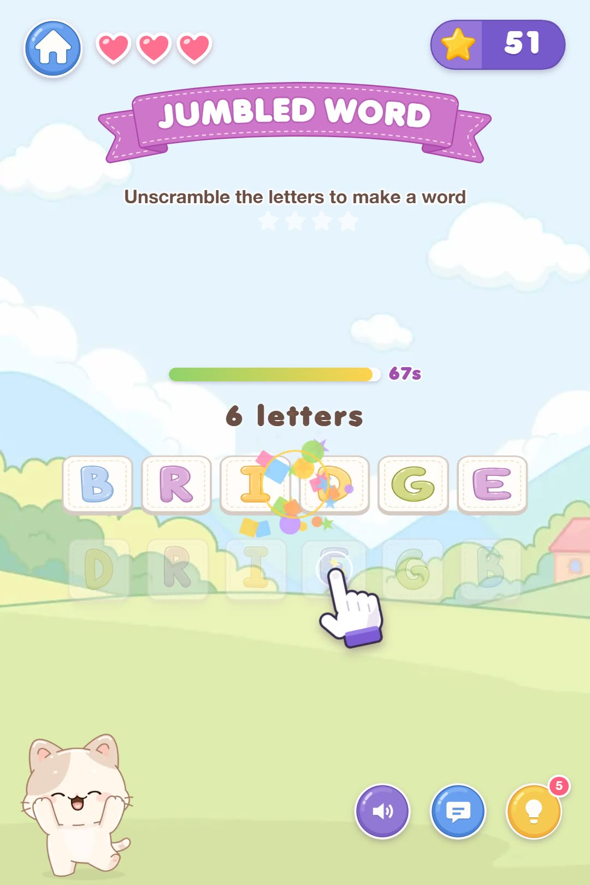
  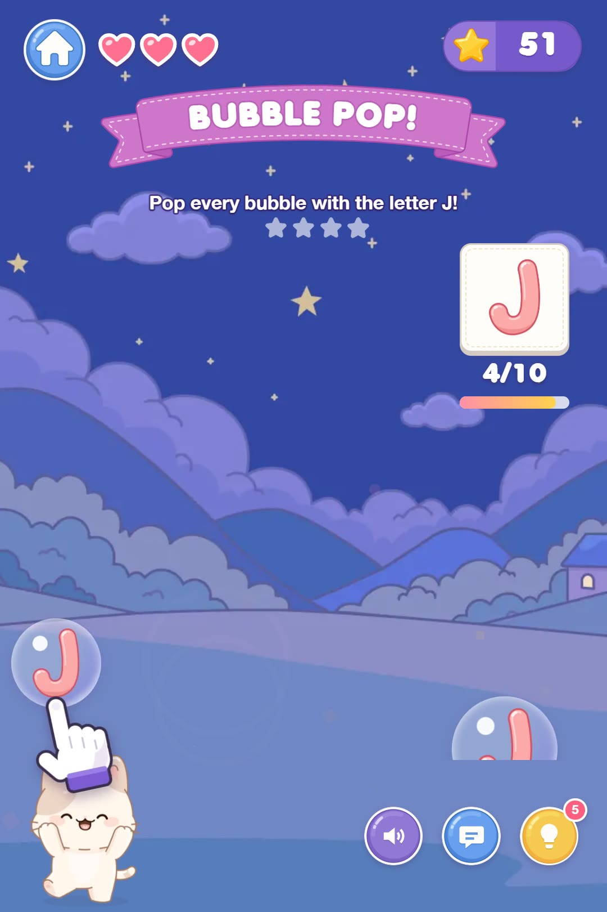
  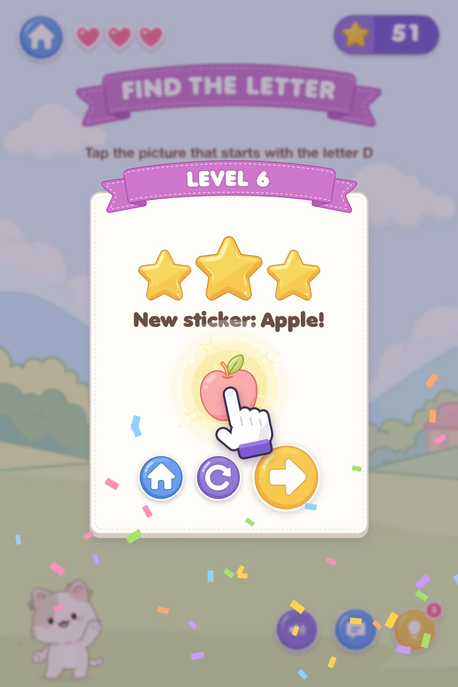

---

## Images

  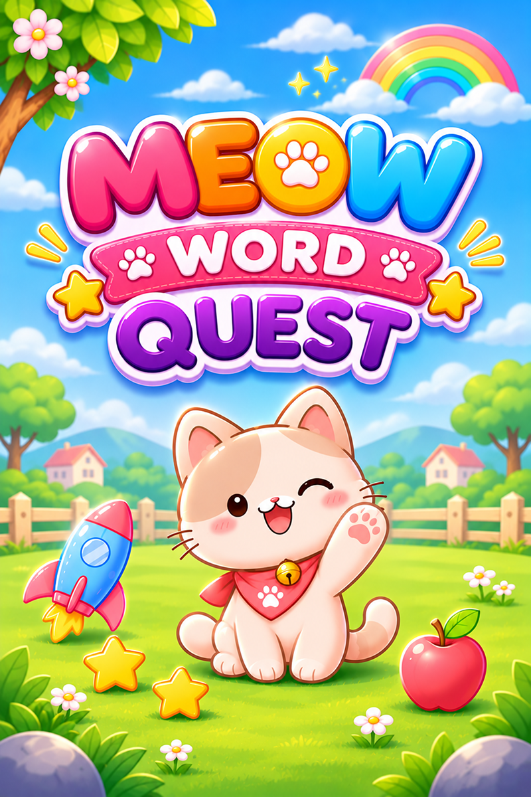
  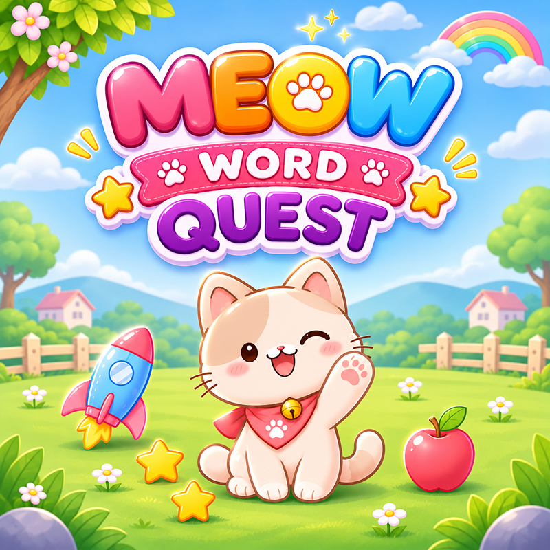

---

## Press kit

Every cover and trailer used on the game portals is in [`media/`](media):

- [`media/images/`](media/images): covers (1920×1080, 800×1200, 800×800)
- [`media/gameplay/`](media/gameplay): screenshots (landscape and portrait)
- Trailers: [landscape](media/trailer-landscape-1920x1080.mp4) and [portrait](media/trailer-portrait-1080x1620.mp4)

---

## Built with

- Plain **JavaScript, HTML and CSS**, no engine
- One small SDK adapter per game portal, so each release ships only that portal's SDK

### Credits

- Art: [CraftPix](https://craftpix.net)
- Sounds and music: [Kenney](https://kenney.nl) (CC0) and "Happy Clappy Loop" by OwlishMedia on [OpenGameArt](https://opengameart.org) (CC0)
- Voice: [Kokoro](https://github.com/hexgrad/kokoro) text-to-speech

---

  <a href="https://bluelolipop1.itch.io/meow-word-quest"><b>▶ Play Meow Word Quest on itch.io</b></a>
  &nbsp;•&nbsp;
  <a href="https://playgama.ai/play/6b4q564zngdqyg"><b>▶ Play on Playgama</b></a>
    
  © Meow Word Quest. All rights reserved. This repository is the game's public page; the source code is private.

